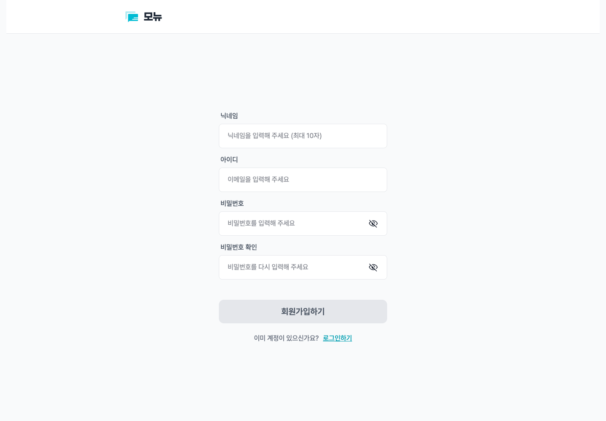

<a name="top"></a>

<div align="center">

[](https://github.com/SB14-GoS/sb14-monew-team01/actions/workflows/ci.yml?query=branch%3Adev) [](https://github.com/SB14-GoS/sb14-monew-team01/pull/195#issuecomment-6723138502)

<a href="https://monew.project-archive.site/"></a>

**관심 있는 주제의 뉴스를 한곳에서**

    

<table align="center">
<tr>
  <td align="left"><b>모뉴 기간</b></td>
  <td align="left">2026.10.20 ~ 2026.11.09</td>
</tr>
<tr>
  <td align="left" valign="top"><b>모뉴 설명</b></td>
  <td align="left">네이버 뉴스와 한국경제 · 조선일보 · 연합뉴스 RSS에서 기사를 모아,<br>관심사에 맞는 뉴스를 읽고 댓글 · 좋아요 · 알림으로 소통하는<br><b>개인화 뉴스 서비스 📰</b>입니다.</td>
</tr>
<tr>
  <td align="left" valign="top"><b>핵심 목표</b></td>
  <td align="left">· 관심사와 키워드 기반 뉴스 수집 · 검색 · 구독<br>· 댓글 · 좋아요 · 알림과 사용자 활동 내역 제공<br>· Spring Batch 기반 기사 수집 · S3 백업 · 복구와 데이터 정리<br>· GitHub Actions 배포 자동화와 CloudWatch Logs 기반 운영</td>
</tr>
<tr>
  <td align="left"><b>관련 링크</b></td>
  <td align="left"><a href="https://monew.project-archive.site/">🌐 배포 링크</a> &nbsp;|&nbsp; <a href="http://sprint-project-1196140422.ap-northeast-2.elb.amazonaws.com/sb/monew/api/swagger-ui/index.html">📑 제공 API 명세</a> &nbsp;|&nbsp; <a href="https://github.com/SB14-GoS/sb14-monew-team01">💻 GitHub</a> &nbsp;|&nbsp; <a href="https://various-smoke-6b3.notion.site/Notion-SB14-MoNew-Team-ec6ff2cbac808318a03e015d40fea585">📝 Notion</a></td>
</tr>
</table>

</div>

---

## 📌 Team 01 · 5인 소개

<table align="center">
<tr>
  <td align="center" width="180"><a href="https://github.com/kim-yejunn"></a><br/><a href="https://github.com/kim-yejunn"></a></td>
  <td align="center" width="180"><a href="https://github.com/rladjwls02"></a><br/><a href="https://github.com/rladjwls02"></a></td>
  <td align="center" width="180"><a href="https://github.com/joyejun"></a><br/><a href="https://github.com/joyejun"></a></td>
  <td align="center" width="180"><a href="https://github.com/Smil-limS"></a><br/><a href="https://github.com/Smil-limS"></a></td>
  <td align="center" width="180"><a href="https://github.com/wongibae"></a><br/><a href="https://github.com/wongibae"></a></td>
</tr>
<tr>
  <td align="center" valign="top"><b>김예준</b><br/><br/><sub><kbd><b>팀장 · 공통 · 활동 내역</b></kbd><br/>· 일정 관리 · 코드 리뷰<br/>· 공통 모듈 · 기사 조회 기록<br/>· 알림 조회 · 활동 내역<br/>· 기사 백업 · 복구</sub></td>
  <td align="center" valign="top"><b>김어진</b><br/><br/><sub><kbd><b>뉴스 기사</b></kbd><br/>· 뉴스 기사 기능<br/>· 네이버 · RSS 기사 수집<br/>· 수집 배치 · 코드 리뷰</sub></td>
  <td align="center" valign="top"><b>조예준</b><br/><br/><sub><kbd><b>댓글 · 좋아요</b></kbd><br/>· 댓글 · 좋아요 기능<br/>· 알림 정리 배치</sub></td>
  <td align="center" valign="top"><b>신상엽</b><br/><br/><sub><kbd><b>관심사 · 인프라</b></kbd><br/>· 관심사 · 구독<br/>· 알림 생성<br/>· AWS 인프라 · 배포 자동화</sub></td>
  <td align="center" valign="top"><b>배원기</b><br/><br/><sub><kbd><b>사용자</b></kbd><br/>· 사용자 기능<br/>· 탈퇴 회원 정리 배치<br/>· 프로젝트 문서</sub></td>
</tr>
</table>

---

## 📌 개발 일정

| 단계 | 기간 | 주요 작업 |
| :--- | :--- | :--- |
| **M1 · 공통 기반** | `~10.21` | 엔티티 · 커서 페이지네이션 · 공통 예외 · CI 구성 |
| **M2 · 도메인 기능** | `10.21 ~ 10.30` | 사용자 · 관심사 · 기사 · 댓글 · 알림 등 핵심 API 구현 |
| **중간 발표** | `10.28` | 진행 상황 공유 및 피드백 |
| **M3 · 연동 · 배치** | `10.29 ~ 11.05` | 이벤트 연동 · 뉴스 수집 · 기사 백업 · 복구 · 활동 내역 |
| **M4 · 고도화 · 안정화** | `11.05 ~ 11.09` | 배포 · 문서 정리 · 커버리지 확인 · 발표 준비 |
| **최종 발표** | `11.10` | 서비스와 구현 결과 발표 |

---

## 📌 서비스 화면

<table>
<tr>
  <td align="center" width="50%"><br/><b>회원가입</b><br/><sub>닉네임 · 이메일 · 비밀번호 입력</sub></td>
  <td align="center" width="50%"><br/><b>뉴스 기사 목록</b><br/><sub>검색 · 정렬 · 관심사 · 출처 · 발행 기간 필터</sub></td>
</tr>
<tr>
  <td align="center" width="50%"><br/><b>기사 상세 · 댓글</b><br/><sub>기사 요약 · 댓글 목록 · 좋아요</sub></td>
  <td align="center" width="50%"><br/><b>관심사 관리</b><br/><sub>관심사 · 키워드 등록 · 수정 · 구독</sub></td>
</tr>
<tr>
  <td align="center" width="50%"><br/><b>사용자 활동 내역</b><br/><sub>작성한 댓글 · 좋아요한 댓글 · 최근 본 기사</sub></td>
  <td align="center" width="50%"><br/><b>알림</b><br/><sub>구독 관심사 새 기사 · 댓글 좋아요 알림</sub></td>
</tr>
</table>

---

## 📌 기술 스택

| 구분 | 기술 |
| :--- | :--- |
| **Language** |  |
| **Backend** |   <br>  <br> |
| **Frontend** |  |
| **Database** |   |
| **Cloud & Infra** |    |
| **Monitoring** |    |
| **CI/CD** |   |
| **Test & Quality** |   <br>   |
| **Development** |   |
| **Docs & Review** |   |
| **Collaboration** |    |

---

## 📌 주요 기능

<details>
<summary><b>사용자</b></summary>

- 회원가입 · 로그인 · 닉네임 수정
- 이메일 중복 검사와 입력값 검증
- 회원 탈퇴와 보관 기간이 지난 사용자 정리

</details>

<details>
<summary><b>관심사</b></summary>

- 관심사와 키워드 등록 · 조회 · 수정 · 삭제
- 이름 · 키워드 검색과 관심사 구독 · 취소
- 구독한 관심사에 맞는 기사 조회

</details>

<details>
<summary><b>뉴스 기사</b></summary>

- 네이버 뉴스 API와 한국경제 · 조선일보 · 연합뉴스 RSS 수집
- 제목 · 요약 검색과 관심사 · 출처 · 발행 기간 필터
- 기사 정렬 · 커서 페이지네이션 · 사용자별 조회 기록
- S3 일별 백업과 기간별 유실 기사 복구

</details>

<details>
<summary><b>댓글 · 좋아요</b></summary>

- 댓글 작성 · 조회 · 수정 · 삭제
- 댓글 좋아요 등록 · 취소
- 댓글 좋아요에 따른 작성자 알림

</details>

<details>
<summary><b>알림</b></summary>

- 구독 관심사의 새 기사와 댓글 좋아요 알림
- 알림 목록 조회 · 개별 및 전체 확인
- 확인한 지 7일이 지난 알림 정리

</details>

<details>
<summary><b>사용자 활동 내역</b></summary>

- 구독 중인 관심사와 작성한 댓글 조회
- 좋아요한 댓글과 최근 본 기사 조회
- MongoDB에 사용자별 활동 내역을 모아 한 번에 조회

</details>

---

## 📌 ERD

사용자 · 관심사 · 기사 · 댓글 · 알림의 관계와 MongoDB 활동 내역을 표시했습니다.

<p align="center"></p>

[ERD Excalidraw 원본](docs/erd.excalidraw)

<details>
<summary><b>관계 설명 보기</b></summary>

| 영역 | 관계 |
| :--- | :--- |
| 관심사 구독 | 사용자는 여러 관심사를 구독하고, 관심사는 여러 키워드를 가집니다. |
| 뉴스 기사 | 하나의 기사가 여러 관심사에 연결될 수 있고, 사용자별 기사 조회 기록을 남깁니다. |
| 댓글 · 좋아요 | 기사에 댓글이 연결되고, 사용자는 댓글에 좋아요를 남길 수 있습니다. |
| 알림 | 관심사 기사 수집과 댓글 좋아요에 따라 사용자에게 알림을 생성합니다. |
| 활동 내역 | MongoDB 사용자별 문서에 구독 관심사와 최근 댓글 · 좋아요 · 기사 조회 각각 최대 10건을 담습니다. |

</details>

---

## 📌 주요 처리 흐름

<details>
<summary><b>1. 뉴스 기사 자동 수집</b></summary>

매시 정각 스케줄러가 수집 작업을 실행합니다. 네이버 뉴스 API와 RSS 피드에서 기사를 읽고, 관심사 키워드와 연결한 뒤 원본 URL을 기준으로 중복을 걸러 PostgreSQL에 저장합니다. 수집 결과는 구독자 알림으로 이어집니다.

</details>

<details>
<summary><b>2. 댓글 좋아요 → 알림</b></summary>

좋아요 저장 트랜잭션이 커밋된 뒤 `CommentLikedEvent`를 받아 댓글 작성자에게 알림을 생성합니다. 자신의 댓글에 누른 좋아요는 알림을 만들지 않습니다.

</details>

<details>
<summary><b>3. 사용자 활동 내역</b></summary>

사용자 · 구독 · 댓글 · 좋아요 · 기사 조회 이벤트를 커밋 후 처리해 MongoDB의 사용자 활동 문서를 갱신합니다. 활동 화면은 사용자별 문서 한 건에서 구독 정보와 최근 활동을 읽습니다.

</details>

<details>
<summary><b>4. 기사 백업 · 복구와 데이터 정리</b></summary>

| 기본 실행 시각 (KST) | 작업 |
| --- | --- |
| 매시 정각 | 네이버 뉴스 API와 RSS 피드 36개에서 기사를 가져옵니다. 관심사 키워드로 기사를 연결하고 원본 URL로 중복을 걸러냅니다. |
| 매일 01:00 | 전날 저장한 기사와 관심사 연결을 일별 JSON으로 S3에 백업합니다. |
| 매일 03:00 | 확인한 지 7일이 지난 알림을 정리합니다. |
| 매일 04:00 | 탈퇴한 지 하루가 지난 회원을 물리 삭제합니다. |

복구는 지정한 기간의 S3 백업을 읽어 PostgreSQL에 없는 기사만 원본 URL 기준으로 복원합니다.

</details>

---

## 📌 배포 구조

### 시스템 구성

<p align="center"></p>

[시스템 구성 Excalidraw 원본](docs/system-architecture.excalidraw)

<details>
<summary><b>구성 요소 자세히 보기</b></summary>

| 영역 | 구성과 역할 |
| :--- | :--- |
| 사용자 진입 | Route 53 도메인과 CloudFront를 통해 서비스에 접속합니다. |
| 웹 화면 | S3에 배포한 React 정적 번들을 CloudFront로 제공합니다. |
| API 서버 | ECS(EC2)에서 Spring Boot 애플리케이션을 실행합니다. 사용자 · 관심사 · 기사 · 댓글 · 알림 · 활동 내역 · 백업 모듈로 구성합니다. |
| 데이터 저장 | PostgreSQL(RDS)에 서비스 데이터를, MongoDB Atlas에 사용자 활동 내역을 저장합니다. |
| 외부 연동 | 네이버 뉴스 API와 언론사 RSS에서 기사를 수집하고, S3에 기사 백업과 로그를 적재합니다. |
| 운영 관찰 | Actuator · Micrometer로 상태와 메트릭을 확인하고, CloudWatch Logs에서 컨테이너 로그를 조회합니다. |

</details>

### CI/CD

<p align="center"></p>

[배포 흐름 Excalidraw 원본](docs/deployment.excalidraw)

<details>
<summary><b>배포 과정 자세히 보기</b></summary>

1. 기능 브랜치에서 `dev` 대상 PR을 생성합니다.
2. GitHub Actions가 포맷 검사 · 빌드 · 테스트 · 커버리지 측정을 수행하고, 팀원이 코드를 리뷰합니다.
3. 검증한 변경을 `dev`에 통합한 뒤, 릴리스 PR을 거쳐 `main`에 반영합니다.
4. `main` 푸시로 CD가 실행되어 컨테이너 이미지를 ECR에 올리고 ECS에 배포합니다.

[CI 워크플로](.github/workflows/ci.yml) · [CD 워크플로](.github/workflows/cd.yml)

</details>

---

## 📌 테스트 및 품질 관리

[](https://github.com/SB14-GoS/sb14-monew-team01/pull/195#issuecomment-6723138502)

JaCoCo 전체 커버리지 **87.54%** — 2026년 11월 9일 [GitHub Actions 측정 결과](https://github.com/SB14-GoS/sb14-monew-team01/pull/195#issuecomment-6723138502) 기준입니다.

<details>
<summary><b>테스트 구성과 실행 방법 보기</b></summary>

| 구분 | 검증 내용 |
| :--- | :--- |
| 단위 테스트 | JUnit Jupiter · Mockito로 도메인과 서비스 로직 검증 |
| 통합 테스트 | Testcontainers로 PostgreSQL · MongoDB를 실행해 저장소와 연동 동작 검증 |
| 아키텍처 테스트 | ArchUnit으로 계층 의존성과 모듈 간 순환 의존 검사 |
| 코드 스타일 | Spotless로 Java 포맷 검사 |
| 커버리지 | JaCoCo 리포트 생성과 PR 커버리지 코멘트 게시 |

```bash
./gradlew test   # 테스트와 JaCoCo 리포트 생성
./gradlew build  # 포맷 검사 · 테스트 · 빌드
```

Docker가 필요합니다. 로컬 커버리지 리포트는 `build/reports/jacoco/test/html/index.html`에서 확인합니다.

</details>

---

<a id="개발-규칙"></a>

## 📌 개발 규칙

<details>
<summary>브랜치·PR·코드 규칙 보기</summary>

| 구분 | 규칙 |
| --- | --- |
| 브랜치 | 최신 `dev`에서 `feature/#12-user-signup`, `fix/#이슈번호-내용` 형식으로 작업합니다. 운영 긴급 수정은 `hotfix/#이슈번호-내용`에서 작업하고 `dev` 반영 후 `main`에 반영합니다. |
| 이슈 | 작업 이슈를 본인에게 할당하고 보드를 `In Progress`로 옮깁니다. 작업 유형·도메인 라벨과 마일스톤을 지정합니다. |
| 커밋 | `타입: 요약 #이슈번호` 형식을 사용합니다. 기능 개발은 Red → Green → Refactor 단계별로 커밋합니다. |
| PR | `dev`로 PR을 열고 본문에 `Closes #이슈번호`를 적습니다. CI 통과와 [CODEOWNERS](.github/CODEOWNERS) 1명 승인 후 **Rebase and merge** 합니다. 브랜치를 최신화할 때는 `origin/dev`에 rebase합니다. |
| 릴리스 | `dev` → `main` PR에서 리뷰를 받은 뒤 팀장이 **fast-forward**로 반영합니다. `main` 푸시가 운영 배포를 시작합니다. |
| 자동 검사 | Gradle 빌드가 Git hooks를 등록합니다. 커밋 전에 Spotless 포맷을 적용하고 메시지 형식을 확인합니다. 푸시 전 `./gradlew build` 검사는 Docker를 사용합니다. |
| 코드 | 요청·응답 DTO를 API 명세와 맞춥니다. 엔티티는 `BaseEntity` 또는 `BaseSoftDeleteEntity`를 상속하고, 논리 삭제 대상의 조회에는 삭제 조건을 반영합니다. 다른 모듈의 엔티티는 ID로 참조합니다. |
| 스타일과 설정 | 클래스는 PascalCase, 변수·메서드는 camelCase, 상수는 UPPER_SNAKE_CASE, 패키지는 소문자를 사용합니다. API 키와 DB 비밀번호는 환경 변수로 관리합니다. |
| 팀 협업 | 30분 이상 막히면 팀에 공유하고, 디스코드 메시지는 확인 표시를 남깁니다. 리뷰 요청을 받은 뒤 24시간 안에 리뷰합니다. |

</details>

---

## 📌 로컬 개발 환경 구동 방법

<details>
<summary><b>실행 방법 펼쳐보기</b></summary>

JDK 17과 Docker가 필요합니다. Docker를 실행한 뒤 아래 명령을 실행하세요. 기본 `local` 프로필에서는 Docker Compose가 PostgreSQL과 MongoDB를 자동으로 시작합니다.

```bash
git clone https://github.com/SB14-GoS/sb14-monew-team01.git
cd sb14-monew-team01
./gradlew bootRun
```

브라우저에서 [로컬 서비스](http://localhost:8080/)를 열거나, 아래 명령으로 서버 상태와 기사 출처 목록을 확인할 수 있습니다.

```bash
curl -fsS http://localhost:8080/actuator/health
curl -fsS http://localhost:8080/api/articles/sources
```

첫 번째 요청은 `status`가 `UP`인 응답을, 두 번째는 `NAVER`, `HANKYUNG`, `CHOSUN`, `YEONHAP`가 포함된 JSON 배열을 반환합니다. 로컬 서버의 API 문서는 [Swagger UI](http://localhost:8080/swagger-ui/index.html)에서 볼 수 있습니다.

네이버 뉴스 수집이나 S3 연동이 필요하면 `.env.example`을 `.env`로 복사한 뒤 해당 기능에 필요한 `NAVER_*`, `AWS_*` 값을 채웁니다. 기본 실행에는 별도 DB 접속 정보가 필요하지 않습니다. [환경변수 예시](.env.example) · [온보딩 가이드](docs/ONBOARDING.md)

</details>

---

## 📌 프로젝트 패키지 전체 구조 살펴보기

기능별로 모듈을 나누고, 각 모듈에서 웹 요청 · 애플리케이션 로직 · 도메인 · 외부 연동을 분리합니다. 모듈 간 호출에는 공개 `api`를 사용합니다.

### 1. 전체 구성

```text
sb14-monew-team01/
├── .github/workflows/                 # CI와 배포 워크플로
├── docs/                              # 프로젝트 문서와 다이어그램
├── src/
│   ├── main/
│   │   ├── java/com/sprint/monew/
│   │   │   ├── user/                  # 사용자
│   │   │   ├── interest/              # 관심사와 구독
│   │   │   ├── article/               # 기사 수집과 조회
│   │   │   ├── comment/               # 댓글과 좋아요
│   │   │   ├── notification/          # 알림
│   │   │   ├── activity/              # 활동 내역
│   │   │   ├── backup/                # 기사 백업과 복구
│   │   │   └── global/                # 공통 설정, 예외, 로깅, 메트릭
│   │   └── resources/                 # 환경별 설정과 정적 웹 파일
│   └── test/                          # 단위·통합·아키텍처 테스트
├── build.gradle                       # 의존성과 빌드 설정
├── compose.yaml                       # 로컬 PostgreSQL·MongoDB 실행
└── Dockerfile                         # 백엔드 컨테이너 이미지
```

### 2. 계층 구성 · 기사 모듈 예시

```text
src/main/java/com/sprint/monew/article/
├── api/                               # 다른 모듈에 공개하는 계약과 이벤트
│   └── ArticleQueryApi.java
├── web/                               # HTTP 요청과 응답
│   └── ArticleController.java
├── application/                       # 서비스 로직과 트랜잭션
│   ├── ArticleService.java
│   └── port/NewsSourceClient.java     # 외부 뉴스 수집 인터페이스
├── domain/                            # 기사 모델과 저장소 인터페이스
│   ├── Article.java
│   └── repository/ArticleQueryRepository.java
└── infra/                             # QueryDSL 조회와 외부 뉴스 연동 구현
    └── ArticleQueryRepositoryImpl.java
```

**기사 검색 요청 흐름**

`ArticleController` → `ArticleService` → `ArticleQueryRepository` (`ArticleQueryRepositoryImpl`) → PostgreSQL

### 3. 공통 영역 (global)

<details>
<summary><b>공통 패키지 구성 보기</b></summary>

```text
global/
├── common/          # 기본 엔티티 · 커서 요청과 응답 · 정렬
├── config/          # JPA · QueryDSL · 스케줄링 · 암호화 · OpenAPI
├── exception/       # 공통 오류 코드 · 예외 · 전역 예외 처리
├── log/             # 로그 S3 업로드와 스케줄러
├── metric/          # 배치 메트릭과 리스너
└── web/             # 요청자 ID · MDC 로그 · SPA 라우팅
```

[공통 예외 처리 가이드](src/main/java/com/sprint/monew/global/exception/EXCEPTION_HANDLING.md) · [온보딩 가이드](docs/ONBOARDING.md) · [프로젝트 요구사항](https://codeit.notion.site/MongoDB-PostgreSQL-v2-3276fd228e8d81c89265f6b5469efbb0)

</details>

### 4. 전체 패키지 구성

<details>
<summary><b>전체 패키지 펼쳐보기</b></summary>

```text
com/sprint/monew/
├── activity/
│   ├── application/
│   ├── domain/
│   │   └── exception/
│   ├── infra/
│   └── web/
│       └── dto/
├── article/
│   ├── api/
│   ├── application/
│   │   └── port/
│   ├── domain/
│   │   ├── exception/
│   │   └── repository/
│   ├── infra/
│   │   └── source/
│   │       └── dto/
│   └── web/
│       └── dto/
├── backup/
│   ├── application/
│   │   └── port/
│   ├── domain/
│   │   └── exception/
│   ├── infra/
│   └── web/
├── comment/
│   ├── api/
│   ├── application/
│   ├── domain/
│   │   ├── exception/
│   │   └── repository/
│   ├── infra/
│   └── web/
│       └── dto/
├── global/
│   ├── common/
│   ├── config/
│   ├── exception/
│   │   └── advice/
│   ├── log/
│   ├── metric/
│   └── web/
├── interest/
│   ├── api/
│   ├── application/
│   ├── domain/
│   │   └── exception/
│   ├── infra/
│   └── web/
│       └── dto/
├── notification/
│   ├── application/
│   ├── domain/
│   │   └── exception/
│   ├── infra/
│   └── web/
│       └── dto/
└── user/
    ├── api/
    ├── application/
    ├── domain/
    └── web/
        └── dto/
```

</details>

---

<div align="center">

### 📰 MONEW

관심 있는 주제의 뉴스를 한곳에서

[서비스 바로가기](https://monew.project-archive.site/) · [맨 위로 ⬆️](#top)

</div>
