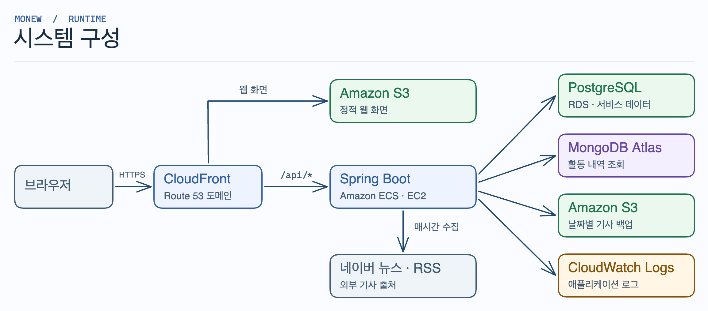
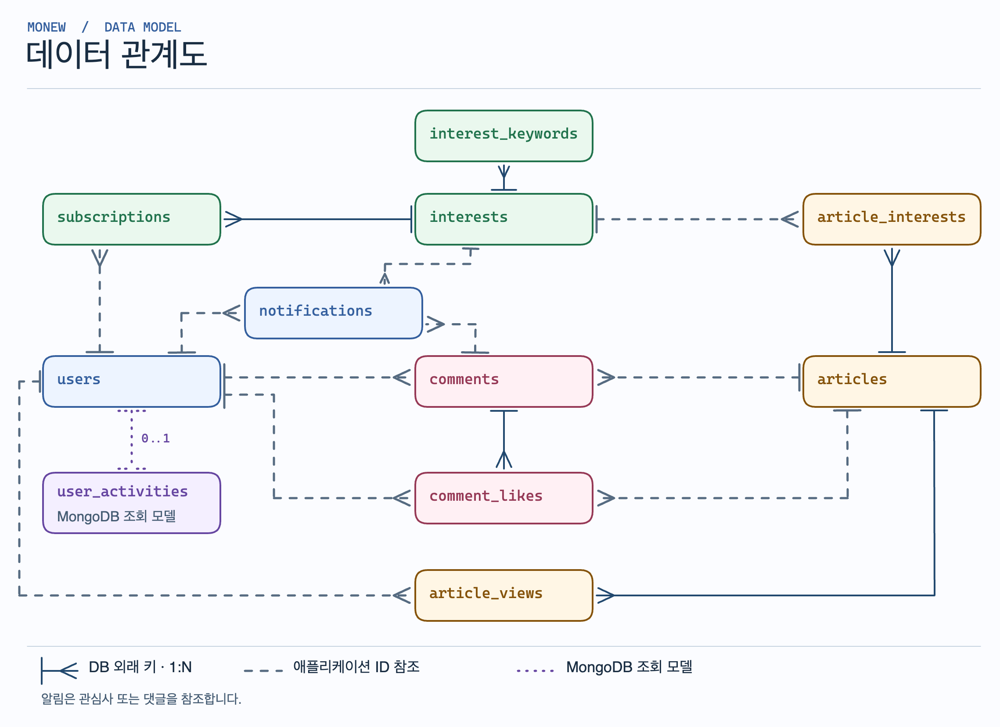
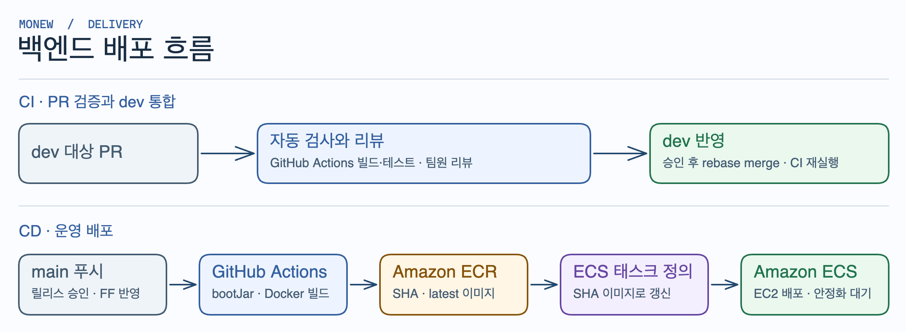

# 📰 모뉴 (MoNew)

**관심 있는 주제의 뉴스를 한곳에서 읽는 서비스입니다.**

모뉴는 네이버 뉴스와 한국경제·조선일보·연합뉴스 RSS에서 매시간 기사를 수집합니다. 관심사를 구독하면 해당 주제의 키워드와 맞는 기사만 모아 볼 수 있습니다.


[](https://github.com/SB14-GoS/sb14-monew-team01/pull/195#issuecomment-6723138502)

[서비스 체험](https://monew.project-archive.site/) · [시스템 설계](#시스템-설계) · [로컬 실행](#로컬-실행) · [개발 문서](#개발-문서)


## 모뉴에서 할 수 있는 일

1. **관심사를 구독합니다.** 기존 관심사에서 ‘인공지능’을 구독하거나, 원하는 주제가 없으면 ‘AI’, ‘생성형 AI’ 같은 키워드를 넣어 새 관심사를 등록합니다.
2. **기사에 의견을 남깁니다.** 기사에 댓글을 달거나 댓글에 좋아요를 누를 수 있습니다. 댓글은 최신순과 좋아요순으로 볼 수 있습니다.
3. **새 소식과 내 활동을 확인합니다.** 구독한 주제에 새 기사가 올라오거나 내 댓글에 좋아요가 달리면 알림을 받습니다. 구독, 읽은 기사, 최근 댓글과 좋아요는 활동 내역에서 다시 볼 수 있습니다.

<details>
<summary>기능별 화면 보기</summary>

**관심사 구독**


**댓글과 좋아요**


**알림**


**활동 내역**


</details>

## 기술 스택

| 분야 | 기술 |
| --- | --- |
| 백엔드 | Java 17, Spring Boot 4.1, Spring MVC, JPA·Hibernate, QueryDSL, Spring Batch |
| 데이터 | PostgreSQL, MongoDB Atlas, Amazon S3 |
| 인프라·배포 | Amazon ECS(EC2), ECR, RDS, CloudFront, Route 53, GitHub Actions |
| 모니터링 | Spring Boot Actuator, Micrometer, Amazon CloudWatch Logs |
| 테스트·품질 | JUnit Jupiter, Mockito, Testcontainers, ArchUnit, JaCoCo, Spotless |
| 개발 환경 | Gradle, Docker Compose, IntelliJ IDEA |
| 협업·API 문서 | GitHub, Notion, CodeRabbit, Swagger UI |

## 시스템 설계

### 시스템 구성



[시스템 구성 Excalidraw 원본](docs/system-architecture.excalidraw)

### 데이터 관계도 (ERD)



[ERD Excalidraw 원본](docs/erd.excalidraw)

### 배포 흐름



[배포 흐름 Excalidraw 원본](docs/deployment.excalidraw)

### 코드 아키텍처

기능별로 모듈을 나누고 각 모듈 안에서 웹 요청 처리, 애플리케이션 로직, 도메인 모델, 외부 연동을 분리합니다. 모듈 사이의 호출은 공개 `api`를 통해 이뤄지며, ArchUnit 테스트가 계층 의존성과 모듈 간 순환 의존을 검사합니다.

<details>
<summary>전체 구성과 계층 구조 보기</summary>

#### 1. 전체 구성

```text
sb14-monew-team01/
├── .github/workflows/                 # CI와 배포 워크플로
├── docs/                              # 프로젝트 문서와 다이어그램
├── src/
│   ├── main/
│   │   ├── java/com/sprint/monew/
│   │   │   ├── user/                  # 사용자
│   │   │   ├── interest/              # 관심사와 구독
│   │   │   ├── article/               # 기사 수집과 조회
│   │   │   ├── comment/               # 댓글과 좋아요
│   │   │   ├── notification/          # 알림
│   │   │   ├── activity/              # 활동 내역
│   │   │   ├── backup/                # 기사 백업과 복구
│   │   │   └── global/                # 공통 설정, 예외, 로깅, 메트릭
│   │   └── resources/                 # 환경별 설정과 정적 웹 파일
│   └── test/                          # 단위·통합·아키텍처 테스트
├── build.gradle                       # 의존성과 빌드 설정
├── compose.yaml                       # 로컬 PostgreSQL·MongoDB 실행
└── Dockerfile                         # 백엔드 컨테이너 이미지
```

#### 2. 계층 구성 · 기사 모듈 예시

```text
src/main/java/com/sprint/monew/article/
├── api/                               # 다른 모듈에 공개하는 계약과 이벤트
│   └── ArticleQueryApi.java
├── web/                               # HTTP 요청과 응답
│   └── ArticleController.java
├── application/                       # 서비스 로직과 트랜잭션
│   ├── ArticleService.java
│   └── port/NewsSourceClient.java     # 외부 뉴스 수집 인터페이스
├── domain/                            # 기사 모델과 저장소 인터페이스
│   ├── Article.java
│   └── repository/ArticleQueryRepository.java
└── infra/                             # QueryDSL 조회와 외부 뉴스 연동 구현
    └── ArticleQueryRepositoryImpl.java
```

**기사 검색 요청 흐름**

`ArticleController` → `ArticleService` → `ArticleQueryRepository` (`ArticleQueryRepositoryImpl`) → PostgreSQL

</details>

## 로컬 개발

### 로컬 실행

JDK 17과 Docker가 필요합니다. Docker를 실행한 뒤 아래 명령을 실행하세요. 기본 `local` 프로필에서는 Docker Compose가 PostgreSQL과 MongoDB를 자동으로 시작합니다.

```bash
git clone https://github.com/SB14-GoS/sb14-monew-team01.git
cd sb14-monew-team01
./gradlew bootRun
```

브라우저에서 [로컬 서비스](http://localhost:8080/)를 열거나, 아래 명령으로 서버 상태와 기사 출처 목록을 확인할 수 있습니다.

```bash
curl -fsS http://localhost:8080/actuator/health
curl -fsS http://localhost:8080/api/articles/sources
```

첫 번째 요청은 `status`가 `UP`인 응답을, 두 번째는 `NAVER`, `HANKYUNG`, `CHOSUN`, `YEONHAP`가 포함된 JSON 배열을 반환합니다. 로컬 서버의 API 문서는 [Swagger UI](http://localhost:8080/swagger-ui/index.html)에서 볼 수 있습니다.

네이버 뉴스 수집이나 S3 연동이 필요하면 `.env.example`을 `.env`로 복사한 뒤 해당 기능에 필요한 `NAVER_*`, `AWS_*` 값을 채웁니다. 기본 실행에는 별도 DB 접속 정보가 필요하지 않습니다. [환경변수 예시](.env.example) · [온보딩 가이드](docs/ONBOARDING.md)

### 테스트와 커버리지

**전체 테스트 커버리지 87.54%** (JaCoCo, 2026년 11월 9일 GitHub Actions 측정). [CI 커버리지 결과](https://github.com/SB14-GoS/sb14-monew-team01/pull/195#issuecomment-6723138502)

```bash
./gradlew test   # 단위·통합 테스트와 커버리지 리포트 생성
./gradlew build  # 포맷 검사, 테스트, 빌드
```

통합 테스트는 Testcontainers로 PostgreSQL과 MongoDB를 실행합니다. 로컬 커버리지 리포트는 `build/reports/jacoco/test/html/index.html`에서 확인할 수 있습니다.

## 개발 문서

| 구분 | 문서 |
| --- | --- |
| 요구사항과 API | [프로젝트 요구사항](https://codeit.notion.site/MongoDB-PostgreSQL-v2-3276fd228e8d81c89265f6b5469efbb0) · [코드잇 제공 API 명세](http://sprint-project-1196140422.ap-northeast-2.elb.amazonaws.com/sb/monew/api/swagger-ui/index.html) |
| 개발 가이드 | [공통 예외 처리](src/main/java/com/sprint/monew/global/exception/EXCEPTION_HANDLING.md) · [CI](.github/workflows/ci.yml) · [CD](.github/workflows/cd.yml) |
| 협업 | [협업 규칙](CONTRIBUTING.md) · [팀 노션](https://various-smoke-6b3.notion.site/Notion-SB14-MoNew-Team-ec6ff2cbac808318a03e015d40fea585) |

## 팀

SB14 중급 프로젝트 · Team 01 · 2026.10.20–2026.11.09

[김예준](https://github.com/kim-yejunn) · [김어진](https://github.com/rladjwls02) · [배원기](https://github.com/wongibae) · [신상엽](https://github.com/Smil-limS) · [조예준](https://github.com/joyejun)
