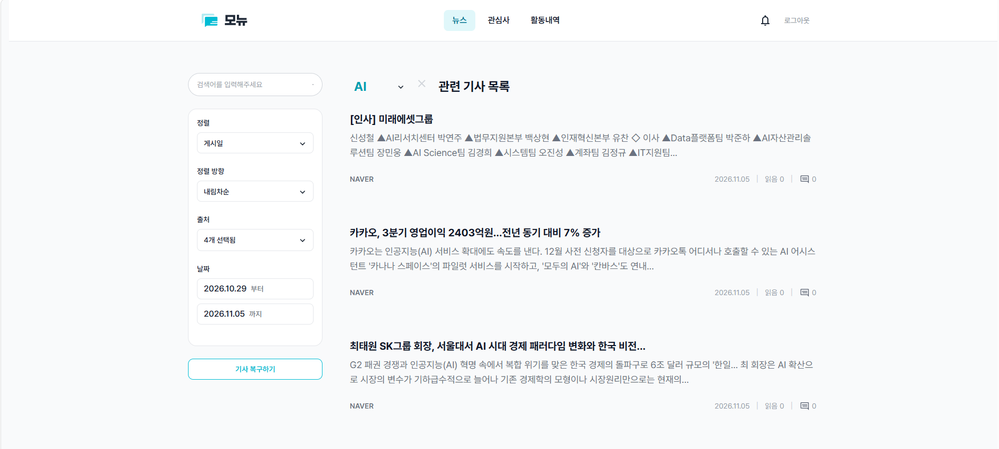
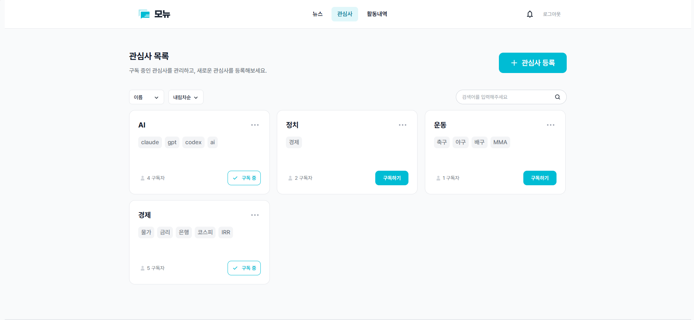
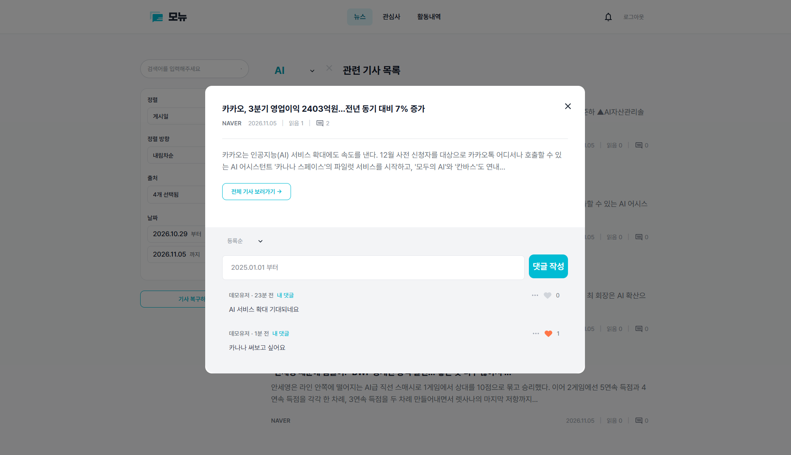
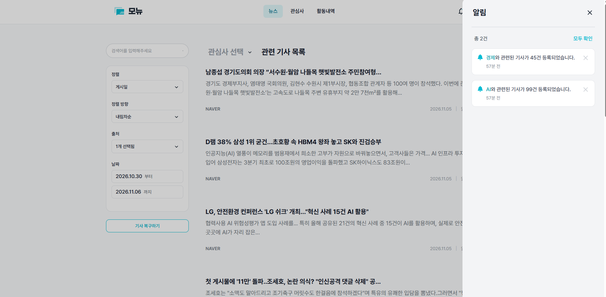
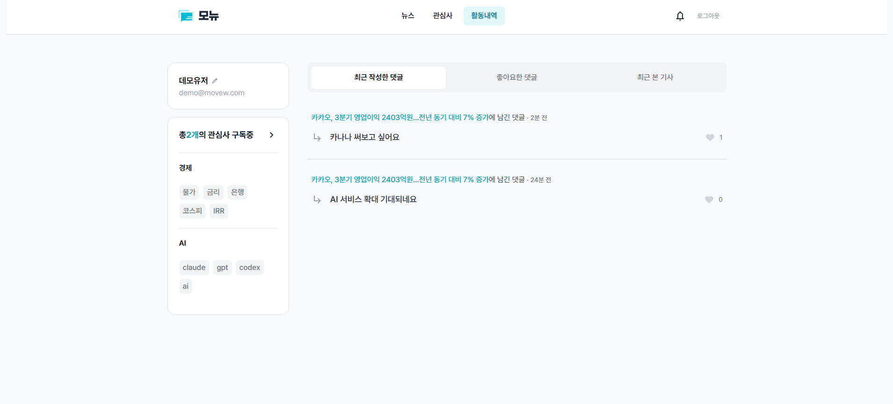
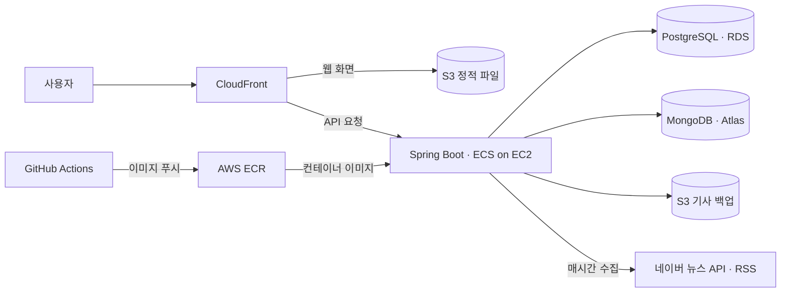

# 📰 모뉴 (MoNew)

**여러 곳에 흩어진 뉴스에서 내가 구독한 주제의 기사만 모아 보는 서비스입니다.**

네이버 뉴스와 언론사 RSS에서 새 기사를 수집합니다. 관심사를 구독하면 관련 기사를 모아 볼 수 있고, 기사에 댓글을 달고 댓글에 좋아요를 누를 수 있습니다. 관심사에 새 기사가 올라오거나 내 댓글에 좋아요가 달리면 알림을 받습니다.

SB14 중급 프로젝트 · Team 01 · 백엔드 5명 · 2026.10.20–2026.11.09

[서비스 체험](https://monew.project-archive.site/) · [빠른 시작](#빠른-시작) · [기술 사례](#기술-사례) · [팀 문서](#팀-문서)



## 주요 기능

| 기능 | 할 수 있는 일 |
| --- | --- |
| 관심사 맞춤 뉴스 | 관심사를 구독하고 관련 기사를 모아 봅니다. 기사는 네이버 뉴스 API와 한국경제·조선일보·연합뉴스 RSS에서 매시간 수집합니다. |
| 댓글과 좋아요 | 기사에 댓글을 달고 마음에 드는 댓글에 좋아요를 누릅니다. 댓글은 최신순이나 좋아요순으로 볼 수 있습니다. |
| 알림 | 구독한 관심사의 새 기사와 내 댓글에 달린 좋아요를 확인합니다. |
| 활동 내역 | 구독 중인 관심사, 최근 댓글, 좋아요, 읽은 기사를 한 화면에서 확인합니다. |

<details>
<summary>기능별 화면 보기</summary>

**관심사 구독**



**댓글과 좋아요**



**알림**



**활동 내역**



</details>

## 빠른 시작

JDK 17과 Docker가 필요합니다. Docker를 실행한 뒤 아래 명령을 실행하세요. 기본 `local` 프로필에서는 Docker Compose가 PostgreSQL과 MongoDB를 자동으로 시작합니다.

```bash
git clone https://github.com/SB14-GoS/sb14-monew-team01.git
cd sb14-monew-team01
./gradlew bootRun
```

브라우저에서 [로컬 서비스](http://localhost:8080/)를 열거나, 아래 명령으로 서버 상태와 기사 출처 목록을 확인할 수 있습니다.

```bash
curl -fsS http://localhost:8080/actuator/health
curl -fsS http://localhost:8080/api/articles/sources
```

첫 번째 요청은 `status`가 `UP`인 응답을, 두 번째는 `NAVER`, `HANKYUNG`, `CHOSUN`, `YEONHAP`가 포함된 JSON 배열을 반환합니다. 로컬 서버의 API 문서는 [Swagger UI](http://localhost:8080/swagger-ui/index.html)에서 볼 수 있습니다.

네이버 뉴스 수집이나 S3 연동이 필요하면 `.env.example`을 `.env`로 복사한 뒤 해당 기능에 필요한 `NAVER_*`, `AWS_*` 값을 채웁니다. 기본 실행에는 별도 DB 접속 정보가 필요하지 않습니다. [환경변수 예시](.env.example) · [온보딩 가이드](docs/ONBOARDING.md)

## 시스템 구성



기사와 관심사 등 서비스의 원본 데이터는 PostgreSQL에 저장합니다. 활동 화면에 필요한 데이터는 MongoDB에 사용자별로 모아 둡니다. Spring Batch로 기사 수집과 백업을 실행하고, GitHub Actions로 백엔드 이미지를 빌드해 ECS에 배포합니다. [ERD](docs/images/erd.png) · [배포 워크플로](.github/workflows/cd.yml)

| 영역 | 기술 |
| --- | --- |
| 백엔드 | Java 17, Spring Boot, Spring Data JPA, QueryDSL, Spring Batch |
| 데이터 | PostgreSQL, MongoDB |
| 실행 및 배포 | Docker Compose, GitHub Actions, AWS ECS·ECR·S3·CloudFront |
| 테스트 | JUnit, Testcontainers, ArchUnit, JaCoCo |

## 기술 사례

### 기사 수집 중 메모리에 쌓이는 데이터 줄이기

네이버 검색 결과를 키워드별로 받아 한꺼번에 저장하는 구조에서는 수집량이 늘수록 메모리에 쌓이는 기사도 늘었습니다. 수집 중 **5,000건이 모일 때마다 저장 로직에 넘기고 버퍼를 비우도록** 변경했습니다. 기존 기사와 관심사 연결도 한 건씩 확인하던 방식에서 **최대 1,000건씩 묶어 조회**하는 방식으로 바꿨습니다. [수집 로직 변경](https://github.com/SB14-GoS/sb14-monew-team01/commit/a868ccbf53f3dd610a1aaba852fe4cce46fab336) · [관련 이슈 #184](https://github.com/SB14-GoS/sb14-monew-team01/issues/184)

### 기사 50만 건에서 날짜순 목록 조회 개선

발행일로 정렬하는 쿼리에 `(published_date, created_at, id)` 복합 인덱스를 추가하고, 다음 페이지를 찾는 커서 조건도 같은 컬럼 순서로 비교하도록 바꿨습니다.

| 기사 50만 건 기준 | 변경 전 | 변경 후 |
| --- | ---: | ---: |
| 첫 페이지 | 35.248 ms | 0.036 ms |
| 중간 페이지 | 33.385 ms | 0.056 ms |

PR에 기록된 로컬 쿼리 실행 시간의 중앙값입니다. [측정 결과와 구현 PR #182](https://github.com/SB14-GoS/sb14-monew-team01/pull/182)

### 활동 내역 화면에 필요한 조회를 한 번으로 줄이기

구독, 댓글, 좋아요, 읽은 기사를 각각 조회하던 화면을 사용자당 MongoDB 문서 하나로 제공하도록 바꿨습니다. 원본 데이터가 커밋된 뒤 이벤트를 받아 문서를 갱신합니다. 댓글과 읽은 기사가 각 1,000건인 사용자 기준으로 **DB 조회가 5회에서 1회**로 줄었고, 로컬 Testcontainers에서 측정한 **p95는 7.6 ms에서 2.6 ms**로 줄었습니다. 워밍업 20회 후 100회 측정한 결과입니다. [조회 모델 이슈 #44](https://github.com/SB14-GoS/sb14-monew-team01/issues/44)

### 로그인 실패 응답의 시간 차이 줄이기

존재하지 않는 이메일로 로그인하면 비밀번호 검증을 건너뛰어 더 빨리 실패했습니다. 존재하지 않는 이메일에도 더미 해시로 비밀번호 검증을 수행하고 실패 메시지를 통일했습니다. 로컬 BCrypt 측정에서 두 실패 경로의 중앙값 차이가 **약 66.7 ms에서 1.5 ms**로 줄었습니다. DB 조회를 제외하고 워밍업 20회 후 100회 측정했습니다. [로그인 이슈 #13](https://github.com/SB14-GoS/sb14-monew-team01/issues/13)

## 개발과 테스트

```bash
./gradlew test   # 테스트 실행 및 JaCoCo 리포트 생성
./gradlew build  # 포맷 검사, 테스트, 빌드
```

통합 테스트는 Testcontainers로 PostgreSQL과 MongoDB를 실행합니다. 코드는 기능별로 나누며, 다른 도메인에 공개하는 계약은 `api` 패키지에 둡니다. ArchUnit 테스트로 모듈 간 순환 의존과 계층 의존 규칙을 검사합니다. [백엔드 패키지](src/main/java/com/sprint/monew) · [CI 워크플로](.github/workflows/ci.yml)

## 팀 문서

| 구분 | 문서 |
| --- | --- |
| 요구사항과 API | [프로젝트 요구사항](https://codeit.notion.site/MongoDB-PostgreSQL-v2-3276fd228e8d81c89265f6b5469efbb0) · [코드잇 제공 API 명세](http://sprint-project-1196140422.ap-northeast-2.elb.amazonaws.com/sb/monew/api/swagger-ui/index.html) |
| 데이터 설계 | [ERD](docs/images/erd.png) |
| 개발 가이드 | [온보딩](docs/ONBOARDING.md) · [공통 예외 처리](src/main/java/com/sprint/monew/global/exception/EXCEPTION_HANDLING.md) |
| 협업 | [협업 규칙](CONTRIBUTING.md) · [팀 노션](https://various-smoke-6b3.notion.site/Notion-SB14-MoNew-Team-ec6ff2cbac808318a03e015d40fea585) |

## 팀원과 역할

| 팀원 | 담당 | GitHub |
| --- | --- | --- |
| 김예준 · 팀장 | 초기 세팅, CI, 활동 내역, 기사 조회수, 기사 백업·복구, 알림 조회 | [@kim-yejunn](https://github.com/kim-yejunn) |
| 김어진 | 공통 예외, 뉴스 기사, 뉴스 수집 | [@rladjwls02](https://github.com/rladjwls02) |
| 배원기 | 사용자, 탈퇴 사용자 정리 배치, README, 일정 관리 | [@wongibae](https://github.com/wongibae) |
| 신상엽 | 관심사·구독, 알림 생성, 배치 메트릭, 로그 S3 적재, AWS 인프라·배포 | [@Smil-limS](https://github.com/Smil-limS) |
| 조예준 | 댓글·좋아요, 알림 정리 배치 | [@joyejun](https://github.com/joyejun) |
