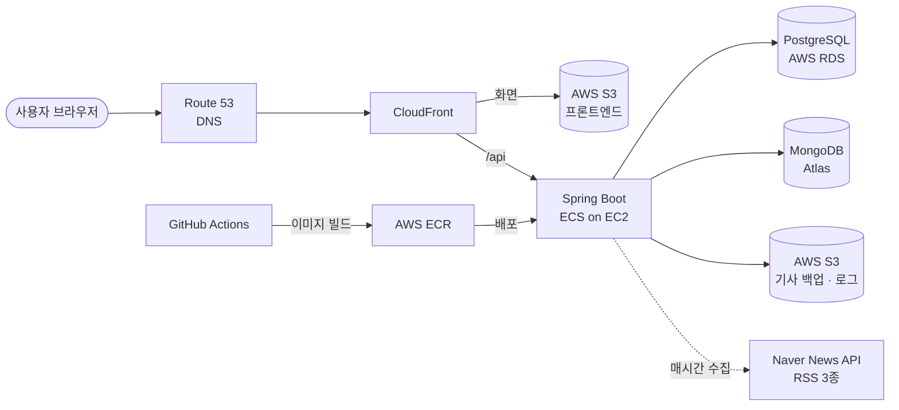

<div align="center">

# 📰 모뉴 (MoNew)

**여러 뉴스 API를 통합해 관심사 맞춤 뉴스를 제공하고, 댓글·좋아요·알림으로 의견을 나누는 서비스**

SB14 중급 프로젝트 · Team 01


<!-- TODO: 커버리지 배지. 현재 CI는 JaCoCo 결과를 PR 댓글로만 남김 (80% 검사는 -PenforceCoverage 옵션을 줄 때만 실행).
     3팀 방식: CI가 dev 빌드 후 배지 SVG를 만들어 별도 브랜치(coverage-badge)에 저장하고 README가 그 파일을 불러옴.
     CI에 배지 생성 단계를 추가하면 아래 주석을 풀어서 사용 (팀장 확인) -->
<!-- [](https://github.com/SB14-GoS/sb14-monew-team01/actions) -->

2026.10.20 ~ 2026.11.09 · 백엔드 5명

[🌐 서비스 바로가기](https://monew.project-archive.site) · [📘 API 명세 (Swagger)](http://sprint-project-1196140422.ap-northeast-2.elb.amazonaws.com/sb/monew/api/swagger-ui/index.html) · [📝 팀 노션](https://various-smoke-6b3.notion.site/Notion-SB14-MoNew-Team-ec6ff2cbac808318a03e015d40fea585)


</div>

<br>

## ✨ 핵심 기능

### 1. 관심사 맞춤 뉴스
네이버 뉴스 API와 한국경제 · 조선일보 · 연합뉴스 RSS에서 기사를 **매시간 자동 수집**하고, 구독한 관심사 키워드에 맞는 기사만 모아 보여줍니다.


### 2. 댓글 · 좋아요
기사에 댓글을 달고 좋아요로 의견을 나눕니다. 최신순 · 좋아요순 정렬과 무한 스크롤을 지원합니다.


### 3. 알림
구독한 관심사에 새 기사가 올라오거나, 내 댓글에 좋아요가 달리면 알림을 받습니다.


### 4. 활동 내역
구독 관심사 · 최근 댓글 · 좋아요 · 본 기사를 한 화면에서 확인합니다. (MongoDB 조회 모델)


<br>

## 🏗️ 아키텍처



- 화면은 S3 + CloudFront로 정적 배포하고, API는 EC2 위 ECS 컨테이너에서 실행합니다.
- 비용을 줄이기 위해 로드밸런서(ALB) 없이 구성하고, MongoDB는 Atlas 무료 플랜을 사용합니다.

<br>

## 💡 기술적 도전과 해결

<!-- 1, 2번 수치: 김예준님 PR #182, #136 본문의 로컬 측정값. 3번: 배원기 로컬 측정 (2026-11-06, 수정 전 코드는 커밋 1ede9cd 이전 버전) -->

### 1. 기사가 쌓일수록 느려지는 목록 조회
- **문제**: 기사 목록 날짜순 조회에 맞는 인덱스가 없어, 기사가 늘수록 첫 페이지 · 중간 페이지 응답이 함께 느려짐
- **해결**: `(published_date, created_at, id)` 정렬 인덱스를 추가하고, 커서 조건을 `(published_date, created_at, id) < (?, ?, ?)` row-value 비교로 바꿔 인덱스를 그대로 타게 함
- **결과**: 기사 50만 건에서 첫 페이지 **35.2ms → 0.04ms**, 중간 페이지 **33.4ms → 0.06ms**. 기사 수가 늘어도 응답 시간이 거의 일정

  | 기사 수 | 첫 페이지 (전 → 후) | 중간 페이지 (전 → 후) |
  |---|---|---|
  | 1만 | 1.6ms → 0.05ms | 0.55ms → 0.04ms |
  | 10만 | 12.5ms → 0.04ms | 6.0ms → 0.05ms |
  | 50만 | 35.2ms → 0.04ms | 33.4ms → 0.06ms |

  <sub>로컬 측정, 중앙값 · [#181](https://github.com/SB14-GoS/sb14-monew-team01/issues/181)</sub>

### 2. 활동 내역 조회의 다중 조인
- **문제**: 활동 내역 한 화면에 구독 · 댓글 · 좋아요 · 본 기사가 모두 필요해, PostgreSQL에서는 쿼리 5번이 필요하고 데이터가 쌓일수록 느려짐
- **해결**: 사용자당 MongoDB 문서 1개를 두고 각 모듈 이벤트로 미리 갱신 (`$push` + `$slice`로 최근 10개만 유지, 커밋 후 실행)
- **결과**: 쿼리 **5회 → 1회**. 댓글 · 본 기사가 1,000개씩 쌓인 사용자 기준 평균 **3.9ms → 1.7ms**(약 2.3배), p95 **7.6ms → 2.6ms**(약 3배). 문서 크기가 고정되어 데이터가 늘어도 일정

  <sub>로컬 Testcontainers, 워밍업 20회 후 100회 측정 · [#44](https://github.com/SB14-GoS/sb14-monew-team01/issues/44)</sub>

### 3. 로그인 응답 시간으로 가입 여부가 드러나는 문제
- **문제**: 없는 이메일이면 비밀번호 비교 없이 바로 실패해, 응답 시간 차이로 가입된 이메일을 추측할 수 있음
- **해결**: 이메일이 없어도 미리 만들어 둔 더미 해시로 `passwordEncoder.matches`를 항상 실행하고, 실패 메시지를 하나로 통일
- **결과**: 없는 이메일과 있는 이메일의 응답 시간 차이 **66.7ms → 1.5ms**. 수정 전에는 없는 이메일이 약 1,300배 빨리 실패했지만, 수정 후에는 두 경우가 측정 오차 수준으로 같아짐

  | 로그인 실패 (중앙값) | 있는 이메일 + 틀린 비밀번호 | 없는 이메일 |
  |---|---|---|
  | 수정 전 | 66.7ms | **0.05ms** |
  | 수정 후 | 67.5ms | **66.0ms** |

  <sub>로컬, BCrypt(strength 10), DB 조회는 mock으로 제외, 워밍업 20회 후 100회 측정 · [#13](https://github.com/SB14-GoS/sb14-monew-team01/issues/13)</sub>

<br>

## 🚀 실행 방법

**필요한 것**: JDK 17 · Docker Desktop (실행 중이어야 함)

```bash
git clone https://github.com/SB14-GoS/sb14-monew-team01.git
cd sb14-monew-team01
./gradlew bootRun    # PostgreSQL · MongoDB 컨테이너가 자동으로 뜸 (compose.yaml)
```

http://localhost:8080 에 접속하면 화면이 열립니다. 테스트는 `./gradlew test`로 실행합니다. (Testcontainers로 DB 자동 기동)

- DB 접속 정보는 따로 설정하지 않아도 됩니다.
- 네이버 뉴스 수집 · S3 백업까지 쓰려면 [`.env.example`](./.env.example)의 `NAVER_*`, `AWS_*` 값을 채워야 합니다.
- 처음이라면 [온보딩 가이드](./docs/ONBOARDING.md)에 설치부터 자주 나는 오류까지 정리되어 있습니다.

<br>

## 📚 문서

| 구분 | 문서 |
|---|---|
| 서비스 | [요구사항](https://codeit.notion.site/MongoDB-PostgreSQL-v2-3276fd228e8d81c89265f6b5469efbb0) · [API 명세 (Swagger)](http://sprint-project-1196140422.ap-northeast-2.elb.amazonaws.com/sb/monew/api/swagger-ui/index.html) · [ERD](docs/images/erd.png) |
| 팀 | [팀 노션](https://various-smoke-6b3.notion.site/Notion-SB14-MoNew-Team-ec6ff2cbac808318a03e015d40fea585) · [협업 규칙](./CONTRIBUTING.md) · [온보딩 가이드](./docs/ONBOARDING.md) · [공통 예외 처리 가이드](src/main/java/com/sprint/monew/global/exception/EXCEPTION_HANDLING.md) |

<sub>API 명세는 코드잇이 제공한 명세 서버이며, 우리 API는 이 명세를 기준으로 구현했습니다.</sub>

<details>
<summary><b>📦 패키지 구조</b></summary>
<br>

기능(도메인)별로 먼저 나누고, 각 도메인 안을 같은 계층 구조로 맞췄습니다. 외부 연동(뉴스 출처, S3)만 인터페이스(port)로 분리했습니다.

```
com.sprint.monew
├── user · interest · article · comment · notification · activity · backup
│   ├── api/            다른 모듈에 공개하는 계약 (조회 인터페이스, DTO record, 이벤트) *
│   ├── web/            Controller, Request/Response DTO, Swagger 문서
│   ├── application/    Service(유스케이스, 트랜잭션), 이벤트 핸들러, 배치
│   │   └── port/       외부 연동 인터페이스 (article: 뉴스 출처, backup: 파일 저장소)
│   ├── domain/         Entity, 도메인 규칙, Repository
│   └── infra/          QueryDSL 구현, 외부 API · S3 클라이언트
└── global/             config · exception · common · web · log · metric
```

<sub>* `api`는 다른 모듈이 가져다 쓰는 user · interest · article · comment에만 있습니다.</sub>

- 다른 모듈은 `api` 패키지만 참조하고, 다른 모듈 엔티티는 연관관계 대신 **ID로만** 참조
- 아래 규칙을 **ArchUnit 테스트**(`ArchitectureTest`)로 빌드마다 자동 검사
  - 모듈은 다른 모듈의 `api`만 의존
  - `domain`은 `web` · `application` · `infra`에 의존하지 않음
  - `web`은 `infra`를 직접 쓰지 않음
  - 모듈 간 순환 의존 없음

</details>

<br>

## 👥 팀원 & 역할

| 이름 | 역할 | 담당 | GitHub |
|---|---|---|---|
| 김예준 | 팀장 | 초기 세팅 · CI · 활동 내역 · 기사 조회수 · 기사 백업/복구 · 알림 조회 | [@kim-yejunn](https://github.com/kim-yejunn) |
| 김어진 | 팀원 | 공통 예외 · 뉴스 기사 · 뉴스 수집 | [@rladjwls02](https://github.com/rladjwls02) |
| 배원기 | 팀원 | 사용자 · 탈퇴 사용자 정리 배치 · README · 일정 관리 | [@wongibae](https://github.com/wongibae) |
| 신상엽 | 팀원 | 관심사 · 구독 · 알림 생성 · 배치 메트릭 · 로그 S3 적재 · AWS 인프라/배포 | [@Smil-limS](https://github.com/Smil-limS) |
| 조예준 | 팀원 | 댓글 · 좋아요 · 알림 정리 배치 | [@joyejun](https://github.com/joyejun) |

**도메인별 구현 상세** (누르면 펼쳐집니다)

<details>
<summary><b>👤 사용자</b> — 배원기</summary>
<br>

**기능**
- 회원가입 · 로그인 · 닉네임 수정
- 논리 삭제(탈퇴) · 물리 삭제
- 탈퇴 후 1일 경과한 사용자 물리 삭제 배치 (매일 04:00)

**구현 포인트**
- 이메일 중복이면 409로 응답하고, 동시에 같은 이메일로 가입해도 한 명만 가입되도록 이름 붙인 DB unique 제약(`uk_users_email`) + `saveAndFlush`로 한 번 더 막음 (그 제약 위반일 때만 409로 변환)
- 탈퇴(논리 삭제)해도 이메일 unique는 유지하고, 1일 뒤 배치가 물리 삭제하면 같은 이메일로 다시 가입 가능
- 로그인 실패 시 이메일 · 비밀번호 중 무엇이 틀렸는지 알려 주지 않고, 없는 이메일이어도 **더미 해시로 비밀번호 비교를 실행**해 응답 시간으로 가입 여부를 알 수 없게 함 (타이밍 공격 방지)
- 물리 삭제 시 사용자 모듈은 `UserDeletedEvent`만 발행하고 각 모듈이 자기 데이터를 정리 (모듈 간 순환 의존 방지). PostgreSQL 데이터는 **같은 트랜잭션**으로 정리되어 실패하면 전체 롤백, MongoDB 활동 내역은 커밋 후 정리

**이슈** · 회원가입 [#12](https://github.com/SB14-GoS/sb14-monew-team01/issues/12) · 로그인 [#13](https://github.com/SB14-GoS/sb14-monew-team01/issues/13) · 정보 수정 [#14](https://github.com/SB14-GoS/sb14-monew-team01/issues/14) · 논리 삭제 [#15](https://github.com/SB14-GoS/sb14-monew-team01/issues/15) · 물리 삭제 [#16](https://github.com/SB14-GoS/sb14-monew-team01/issues/16) · 탈퇴 사용자 정리 배치 [#42](https://github.com/SB14-GoS/sb14-monew-team01/issues/42)

</details>

<details>
<summary><b>🏷️ 관심사 · 구독</b> — 신상엽</summary>
<br>

**기능**
- 관심사 등록 (이름 **유사도 80% 이상이면 중복으로 거부**) · 키워드 수정 · 물리 삭제
- 관심사 목록 검색 · 정렬 (커서 페이지네이션)
- 구독 · 구독 취소

**구현 포인트**
<!-- 초안: PR 본문 기반, 담당자 확인 필요 -->
- 관심사 이름 유사도는 **레벤슈타인 거리**로 계산해 80% 이상이면 등록 거부
- 목록 조회는 QueryDSL 동적 커서로 구현하고, 키워드 fetch join과 `subscribedByMe` IN 쿼리로 **N+1 방지**. 구독자 수 정렬은 동점일 때 id를 커서에 포함해 누락 · 중복 방지
- 동시에 같은 관심사를 구독하면 (사용자, 관심사) unique 제약 위반을 `saveAndFlush`로 바로 감지해 500 대신 **409**로 응답
- 구독자 수는 `@Modifying` 쿼리로 DB에서 바로 증감해 동시 요청에도 숫자가 틀어지지 않음
- 구독 취소는 조회 없이 바로 삭제하고, 지워진 행이 0개면 404로 응답
- 구독 · 구독 취소 · 관심사 삭제 시 이벤트를 발행해 활동 내역 등 다른 모듈이 후속 처리

**이슈** · 등록 [#17](https://github.com/SB14-GoS/sb14-monew-team01/issues/17) · 키워드 수정 [#18](https://github.com/SB14-GoS/sb14-monew-team01/issues/18) · 삭제 [#19](https://github.com/SB14-GoS/sb14-monew-team01/issues/19) · 목록 조회 [#20](https://github.com/SB14-GoS/sb14-monew-team01/issues/20) · 구독 · 구독 취소 [#21](https://github.com/SB14-GoS/sb14-monew-team01/issues/21)

</details>

<details>
<summary><b>📰 뉴스 기사</b> — 김어진 · 김예준</summary>
<br>

**기능**
- 다중 출처 수집 (Naver API · RSS) · 매시간 수집 배치 · 키워드 필터링 · 중복 방지
- 목록 검색 · 필터 · 정렬 (커서 페이지네이션) · 단건 조회 · 출처 목록
- 논리 · 물리 삭제 · 기사 뷰(조회수)

**구현 포인트**
<!-- 초안: PR 본문 기반, 담당자 확인 필요 -->
- Naver API와 RSS 3사 결과를 공통 모델 `RawArticle`로 변환해 출처가 늘어도 수집 로직은 그대로 사용
- 원본 URL(`sourceUrl`) 기준으로 중복 기사를 거르고, 이미 있는 기사에는 빠진 관심사 연결만 추가
- 출처 하나가 실패해도 나머지 출처는 계속 수집 · 저장 (Spring Batch Job, 매시 정각 실행)
- 목록은 offset 대신 `(정렬 값, 생성 시각)` 복합 커서(`nextCursor`, `nextAfter`)로 무한 스크롤 지원
- 기사 삭제 시 댓글을 직접 지우지 않고 **이벤트만 발행** → 댓글 모듈 리스너가 정리 (모듈 간 직접 의존 제거)
- 목록 · 단건 응답에 요청 사용자의 읽음 여부 포함, 논리 삭제된 기사는 조회 불가

**이슈** · 목록 조회 [#22](https://github.com/SB14-GoS/sb14-monew-team01/issues/22) · 단건 조회 [#23](https://github.com/SB14-GoS/sb14-monew-team01/issues/23) · 출처 목록 [#25](https://github.com/SB14-GoS/sb14-monew-team01/issues/25) · 논리 · 물리 삭제 [#26](https://github.com/SB14-GoS/sb14-monew-team01/issues/26) · Naver [#36](https://github.com/SB14-GoS/sb14-monew-team01/issues/36) · RSS [#37](https://github.com/SB14-GoS/sb14-monew-team01/issues/37) · 수집 처리 [#38](https://github.com/SB14-GoS/sb14-monew-team01/issues/38) · 수집 배치 [#39](https://github.com/SB14-GoS/sb14-monew-team01/issues/39) · 기사 뷰 · 조회수 [#24](https://github.com/SB14-GoS/sb14-monew-team01/issues/24)

</details>

<details>
<summary><b>💬 댓글</b> — 조예준</summary>
<br>

**기능**
- 등록 · 수정 · 논리 · 물리 삭제
- 기사별 댓글 목록 (최신순 · 좋아요순)
- 댓글 좋아요 · 좋아요 취소

**구현 포인트**
<!-- 초안: PR 본문 기반, 담당자 확인 필요 -->
- 최신순 · 좋아요순 커서 페이지네이션, 응답에 작성자 닉네임 · 좋아요 수 · 내가 좋아요했는지 포함
- 작성자가 아니면 수정 · 삭제 시 **403**
- 이미 삭제된 댓글이나 동시 삭제 상황에서도 기사의 댓글 수가 **두 번 줄지 않도록** 처리
- 같은 댓글에 좋아요를 다시 누르면 중복으로 거부하고, 동시 요청에서도 좋아요 수가 맞는지 테스트로 검증
- 사용자 · 기사가 삭제되면 이벤트를 받아 관련 댓글과 좋아요를 정리

**이슈** · 등록 [#27](https://github.com/SB14-GoS/sb14-monew-team01/issues/27) · 목록 조회 [#28](https://github.com/SB14-GoS/sb14-monew-team01/issues/28) · 수정 [#29](https://github.com/SB14-GoS/sb14-monew-team01/issues/29) · 논리 · 물리 삭제 [#30](https://github.com/SB14-GoS/sb14-monew-team01/issues/30) · 좋아요 · 좋아요 취소 [#31](https://github.com/SB14-GoS/sb14-monew-team01/issues/31)

</details>

<details>
<summary><b>🔔 알림</b> — 김예준 · 신상엽 · 조예준</summary>
<br>

**기능**
- 관심사 신규 기사 알림 · 댓글 좋아요 알림 생성
- 알림 목록 조회 · 확인 · 전체 확인
- 확인 후 7일 지난 알림 정리 배치

**구현 포인트**
<!-- 초안: PR 본문 기반, 담당자 확인 필요 -->
- 기사 수집 · 댓글 좋아요가 일어나면 이벤트를 받아 알림 생성 (`ArticlesCollectedEvent` → 관심사 신규 기사 알림)
- 알림 종류별 정적 팩토리 메서드(`ofInterestArticle`, `ofCommentLike`)로 생성 규칙을 엔티티에 모음
- 확인하지 않은 알림만 최신순 커서 페이지네이션으로 조회, 단건 · 전체 확인 지원
- 확인한 지 7일이 지난 알림만 매일 03:00(KST) 배치로 삭제하고, 확인하지 않은 알림은 보존

**이슈** · 알림 생성 [#32](https://github.com/SB14-GoS/sb14-monew-team01/issues/32) · 목록 조회 [#33](https://github.com/SB14-GoS/sb14-monew-team01/issues/33) · 확인 · 전체 확인 [#34](https://github.com/SB14-GoS/sb14-monew-team01/issues/34) · 확인한 알림 정리 배치 [#43](https://github.com/SB14-GoS/sb14-monew-team01/issues/43)

</details>

<details>
<summary><b>📊 활동 내역</b> — 김예준</summary>
<br>

**기능**
- 구독 관심사 · 최근 댓글 · 좋아요 · 본 기사를 **MongoDB 조회 모델**로 한 번에 제공

**구현 포인트**
<!-- 초안: PR 본문 기반, 담당자 확인 필요 -->
- 사용자당 MongoDB 문서 1개(`user_activities`)를 미리 갱신해 두고, 조회 시 **조인 없이 문서 하나만** 읽음
- 이벤트 계약(record)을 먼저 머지해 각 담당자가 기능을 만들면서 이벤트만 발행하면 되도록 작업을 병렬화
- `$push` + `$slice 10`, `$pull` 같은 부분 갱신만 사용해 문서를 읽고 다시 저장하지 않음 → 동시 요청에도 안전
- 리스너는 커밋 후(`AFTER_COMMIT`) 실행하고 예외는 로그만 남겨, 활동 내역 실패가 원래 요청을 깨지 않음
- 댓글 · 기사 · 사용자가 삭제되면 **다른 사용자 문서에 남은 항목까지** 정리

**이슈** · 활동 내역 조회 [#35](https://github.com/SB14-GoS/sb14-monew-team01/issues/35) · MongoDB 조회 모델 [#44](https://github.com/SB14-GoS/sb14-monew-team01/issues/44)

</details>

<details>
<summary><b>💾 백업 · 복구 · 배치 모니터링</b> — 김예준 · 신상엽</summary>
<br>

**기능**
- 기사를 날짜 단위로 S3에 백업하는 배치
- S3 백업과 DB를 비교해 유실된 기사 복구
- 배치 작업 커스텀 메트릭 수집
- 날짜별 애플리케이션 로그 S3 적재

**구현 포인트**
<!-- 초안: PR 본문 기반, 담당자 확인 필요 -->
- 매일 03:00(KST) 전날 기사를 `articles/yyyy-MM-dd.json`으로 S3에 저장 (Spring Batch Job). 하루 범위는 `[자정, 다음 날 자정)`으로 잡아 경계 시각 기사가 두 번 들어가거나 빠지지 않음
- 백업 파일에 **기사별 관심사 id도 함께 저장**해, 복구한 기사가 관심사와 다시 연결되도록 설계
- 복구 시 `sourceUrl` 기준으로 DB에 없는 기사만 저장하고, 날짜별 복구 결과를 반환
- 배치 수집 건수 · 실패 건수 · 소요 시간을 커스텀 메트릭(Counter, Timer)으로 수집하는 리스너 구현

**이슈** · 기사 백업 배치 [#40](https://github.com/SB14-GoS/sb14-monew-team01/issues/40) · 기사 복구 [#41](https://github.com/SB14-GoS/sb14-monew-team01/issues/41) · 배치 커스텀 메트릭 [#45](https://github.com/SB14-GoS/sb14-monew-team01/issues/45) · 날짜별 로그 S3 적재 [#46](https://github.com/SB14-GoS/sb14-monew-team01/issues/46)

</details>

### 협업 방식
- `dev` 기준 이슈별 브랜치 → PR · 리뷰 승인 → **Rebase and merge** (한 줄 히스토리)
- TDD 단계별 커밋 · CodeRabbit AI 리뷰 · Git hooks(포맷 · 커밋 메시지 · 빌드)
- GitHub Actions CI(빌드 · 테스트 · 커버리지 코멘트) · CD(AWS ECS 자동 배포)

자세한 규칙은 [CONTRIBUTING.md](./CONTRIBUTING.md)를 참고하세요.
